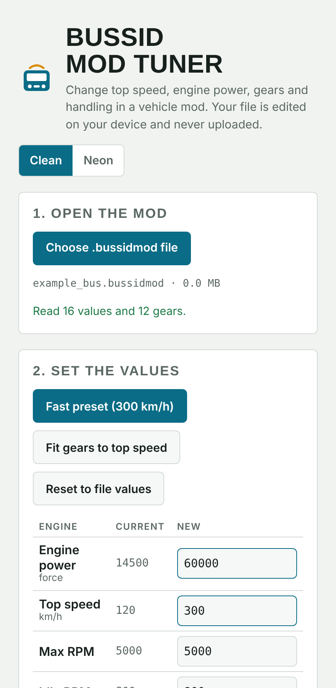
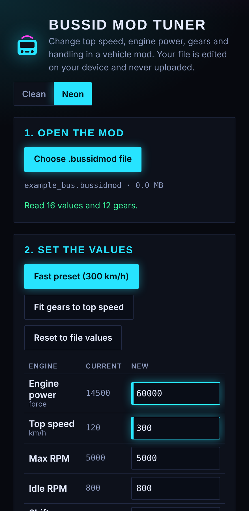

# BUSSID Mod Tuner

Edit **top speed, engine power, gears and handling** in Bus Simulator Indonesia (BUSSID) vehicle mods, right in your browser. Your mod file is edited on your own device and is never uploaded, so there is no size limit.

<p>
  
  
</p>

## Use it online

**Open the tool: https://fawazbhseo.in/tools/bussid-mod-tuner/**

It works in any modern browser on a phone, tablet or computer. Nothing to install, no account, and no upload: your mod file stays on your device.

1. Open the link above.
2. Tap **Choose .bussidmod file** and pick your vehicle mod.
3. Change the values you want, or tap **Fast preset (300 km/h)**. Tap **Fit gears to top speed** after you change the top speed.
4. Tap **Save edited mod**. The edited copy downloads to your device.
5. Copy that file into BUSSID the way you normally install mods.

If your browser adds `.txt` to the end of the saved file name, rename it so it ends in `.bussidmod`.

### Questions

**Is my mod uploaded anywhere?** No. The page reads and edits the file inside your browser. There is no server. See [SECURITY.md](SECURITY.md).

**Does it change my original file?** No. It saves a new edited copy. Keep the original as a backup anyway.

**Does it work offline?** Open the page once, then save it (*Save page as*) and use it from your device. The fonts will fall back to system fonts.

**My mod shows "Not found in this mod".** That mod uses a different layout from the one this tool was built on. Please [open an issue](https://github.com/fawazbhseoin/bussid-mod-tuner/issues/new/choose) and follow the steps in [CONTRIBUTING.md](CONTRIBUTING.md) so it can be added. Do not attach the mod itself.

**The bus is too fast, too slow or unstable.** Lower or raise `force` (engine power) first, then check tyre grip and anti-roll. Use **Reset to file values** to start again.

## What it does

1. Open a `.bussidmod` vehicle file.
2. See the current values and change any of them.
3. Save the edited copy and upload it to the game.

| Group | Values you can change |
|---|---|
| Engine | engine power (`force`), top speed (`maxSpeed`), `maxRPM`, `idleRPM`, `shiftUpRPM` |
| Handling | mass, centre of mass height, tyre grip, anti-roll, steering angle, rolling resistance, brake force, traction control, brake assist, steering limit and assist |
| Gearbox | ratio and shift speed of every gear, or **Fit gears to top speed** to rebuild the table for a new top speed |

There is a **Fast preset (300 km/h)** button for a quick start, and a **Clean / Neon** switch for the look.

## Why the gearbox matters

Raising `maxSpeed` alone does not make a bus faster. The shift speeds and the high-gear ratios in the gear table also cap speed and acceleration. **Fit gears to top speed** rebuilds them so the last gear reaches your top speed with usable pull.

## Privacy

Everything runs in the page. The file is read and edited in your browser's memory, and nothing is sent anywhere. See [SECURITY.md](SECURITY.md).

## Command line

For scripting, a small Node.js tool shares the same code (Node 18 or newer, no dependencies):

```bash
node tools/cli.js mod.bussidmod                              # print current values
node tools/cli.js mod.bussidmod out.bussidmod --preset fast300
node tools/cli.js mod.bussidmod out.bussidmod --set force=45000 maxSpeed=250 --fit-gears
```

## Hosting your own copy

The official copy is at https://fawazbhseo.in/tools/bussid-mod-tuner/. You are welcome to host your own, because the whole app is one file, `index.html`.

- **Any web host (cPanel, Hostinger, etc.):** upload `index.html` to a folder on your site, for example `public_html/tools/bussid-mod-tuner/`.
- **GitHub Pages:** in your fork go to *Settings, Pages*, choose *Deploy from a branch*, pick `main` and the `/ (root)` folder.
- **Your own computer:** double-click `index.html`. It runs from your disk with no server.

The [licence](LICENSE) only requires that you keep the copyright notice, but please also keep the credit line in the footer when you host a copy.

## Development

```bash
npm test          # 9 tests, no dependencies
npm run build     # rebuilds index.html from src/page.html and src/core.js
```

| Path | What it is |
|---|---|
| `src/core.js` | Reading and editing logic, shared by the page and the CLI |
| `src/page.html` | The page (markup, styles, interface code) |
| `index.html` | Built single-file app. Do not edit by hand, run `npm run build` |
| `tools/cli.js` | Command-line version |
| `tests/` | Tests and a synthetic fixture |
| `docs/FORMAT.md` | What is known about the file layout |

## Limitations

- This works from reverse-engineered knowledge of the file layout, not an official specification. Read [docs/FORMAT.md](docs/FORMAT.md) for what is verified and what is guessed.
- It was built and tested against one real mod. Other mods may use a different layout, and the page tells you which values it could not find.
- Values are changed, not validated. Extreme numbers can make a vehicle behave badly or crash the game. Keep a copy of the original file.
- It edits numbers only. It does not change models, textures or sounds.

## Credits and fair use

This tool does not include any mod. Mods belong to their authors, and many ask for credit when you share edited versions. Keep the original authors' credits, and do not re-upload someone else's mod without their permission. This project is not affiliated with the BUSSID developers.

## Contributing

Bug reports, mods that fail to open, and pull requests are welcome. Please read [CONTRIBUTING.md](CONTRIBUTING.md) and the [Code of Conduct](CODE_OF_CONDUCT.md).

## Author

Built by **Fawaz BH** ([fawazbhseo.in](https://fawazbhseo.in)). Licensed under the [MIT License](LICENSE).
